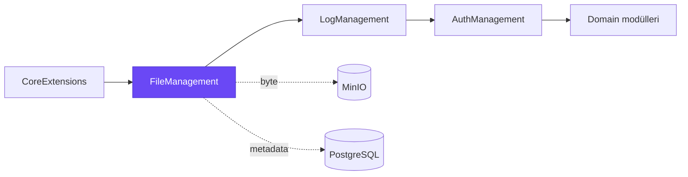
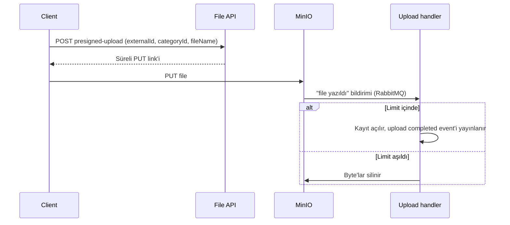
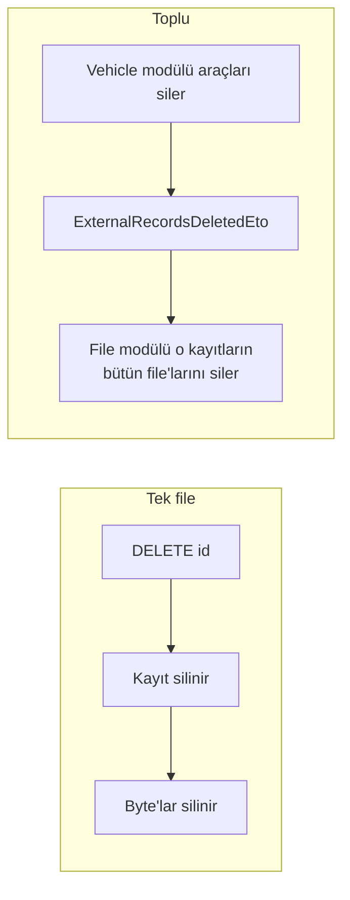

# Byd.FileManagement

Platformun file modülü. Başka bir modülün kaydına file ekler, okur, süreli link üretir ve siler. Byte'lar MinIO'da,
metadata PostgreSQL'de durur. Modüller kendi file tablosunu ya da MinIO client'ını yazmaz; bu modülü kullanır.



Her file iki şeyle adreslenir: ait olduğu kaydın id'si (`ExternalId`, örneğin bir aracın id'si) ve türü (`CategoryId`,
örneğin "ruhsat"). Bir modül "bu aracın ruhsatlarını getir" der, file modülü gerisini halleder.

## Capabilities

| Capability | Ne sağlar |
|---|---|
| [File category](#file-category) | Belge türleri ve tür başına boyut limiti |
| [Upload](#upload) | Küçük file'lar için API'den, büyük file'lar için doğrudan MinIO'ya upload |
| [Read ve download](#read-ve-download) | Kayda ya da kategoriye göre listeleme, metadata ya da içerikle |
| [Presigned link](#presigned-link) | Client'ın MinIO'dan doğrudan indirebileceği süreli link |
| [Delete](#delete) | Tek file silme ya da bir modülün sildiği kayıtların file'larını toplu silme |
| [Upload completed event](#upload-completed-event) | File hazır olunca diğer modüllere haber verme |
| [Scope](#scope) | File'lar tenant'a ve yükleyen modüle bağlı |
| [Storage provider](#storage-provider) | MinIO yerine başka bir blob provider kullanabilme |

## File category

Category bir belge türüdür: "ruhsat", "fatura", "kapak görseli" gibi. File modülü kendi category'sini seed etmez;
category'yi onu kullanan modül tanımlar. Her category kendi boyut limitini (`MaxFileSize`) koyabilir.

## Upload

İki yol vardır. Küçük file'lar API'den, büyük file'lar ve browser upload'ları doğrudan MinIO'ya gider.

| | API upload | Presigned upload |
|---|---|---|
| Endpoint | `POST upload` | `POST presigned-upload` |
| Byte'lar nereden geçer | API request body'si | Client'tan doğrudan MinIO'ya |
| Boyut limiti | Yaklaşık 20 MB | Category'nin `MaxFileSize` değeri, yoksa 20 MB |
| Kayıt ne zaman açılır | Hemen | MinIO "file yazıldı" bildirimi gelince |



Presigned yolda file API'ye hiç uğramaz; API sadece link verir ve sonucu kaydeder.

## Read ve download

| İhtiyaç | Endpoint |
|---|---|
| Bir kaydın bir category'deki file'ları | `by-category` |
| Birden çok kaydın file'ları | `by-external-ids` |
| File'lar içerikleriyle birlikte | `by-category/with-content`, `by-external-id-and-category/with-content` |
| Tek file'ın içeriği | `{id}/download` (JSON) ya da `{id}/download/content` (browser'ın indirebileceği ham file) |
| Filter, sort, paging | `filtered-list`, `filtered-count` (core'un dynamic list query'si) |

Content type tabloda tutulmaz; file adının uzantısından çıkarılır.

## Presigned link

`{id}/presigned-url` tek file için, `by-external-id-and-category/presigned-urls` bir kaydın bütün file'ları için MinIO'ya
giden süreli link üretir. Client file'ı API'yi yormadan doğrudan indirir. Default süre 1 saattir, 7 güne kadar verilebilir.

## Delete



Toplu silme distributed event'le yürür: kaydını silen modül file modülünü doğrudan çağırmaz, sadece event yayınlar.

```csharp
await DistributedEventBus.PublishAsync(new ExternalRecordsDeletedEto
{
    TenantId = CurrentTenant.Id,
    ExternalIds = deletedIds
});
```

## Upload completed event

File'ın kaydı kesinleşince (API upload'ta hemen, presigned upload'ta bildirim işlenince) `StoredFileUploadCompletedEto`
yayınlanır. File'ı bekleyen modül bu event'i dinler; polling yapmaz. Event file'ın id'sini, kaydını, category'sini,
tenant ve organization'ını taşır.

## Scope

File tenant'a bağlıdır ve yükleyenin organization'ını taşır; query'ler aktif tenant'la sınırlanır. File'ı yükleyen
modülün adı her kayda otomatik yazılır, çağıran göndermez.

## Storage provider

Default provider MinIO'dur ve bağlantı ABP setting'lerinden okunur (`FileManagement.MinioSettings.*`). Başka bir provider
kullanacak host `FileManagementModuleOptions.IsDefaultStorageEnabled` değerini kapatıp blob container'ı kendisi
yapılandırır.

## Modülde kullanım

Template'ten üretilen modül file'ı log ve auth paketleri üzerinden alır. Kod içinden kullanım:

```csharp
var file = await StoredFiles.UploadAsync(new UploadStoredFileDto
{
    ExternalId = vehicle.Id,
    CategoryId = licenseCategoryId,
    FileName = "ruhsat.pdf",
    Data = bytes
});
```

| Host config | Ne için |
|---|---|
| `FileManagement.MinioSettings.EndPoint`, `AccessKey`, `SecretKey`, `BucketName` | MinIO bağlantısı |
| `RabbitMQ` | Toplu silme event'i ve MinIO bildirimleri |
| `Redis` (birden çok instance varsa) | Bekleyen presigned upload'lar distributed cache'te durur |

MinIO bucket'ı "file yazıldı" bildirimlerini RabbitMQ'daki `Byd.Minio` exchange'ine göndermelidir.

| Permission | Ne verir |
|---|---|
| `FileManagement.FileCategories.View` / `.Manage` | Category'leri görmek / yönetmek |
| `FileManagement.StoredFiles.View` / `.Manage` | File görmek ve indirmek / yüklemek ve silmek |

## Geliştirme

```bash
dotnet build Byd.FileManagement.slnx
dotnet test Byd.FileManagement.slnx
```
