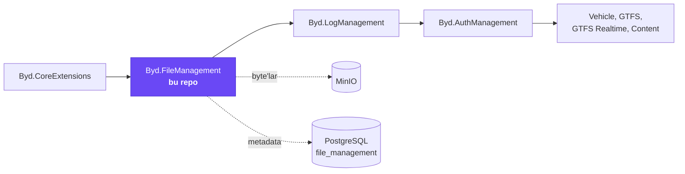
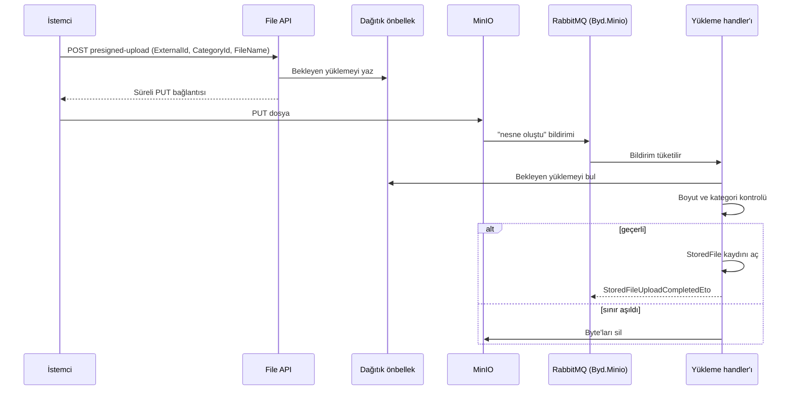
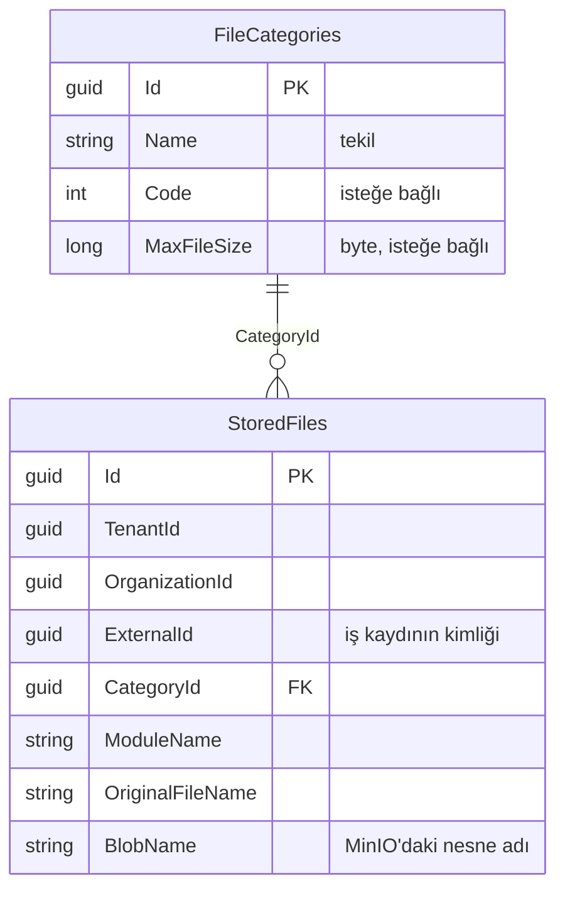

# Byd.FileManagement

[](https://www.nuget.org/packages/Byd.FileManagement.Domain)


Platformun dosya modülü. Başka bir modülün kaydına dosya ekler, okur, süreli bağlantı üretir ve siler. Her dosya iki
şeyle adreslenir: dosyanın ait olduğu iş kaydının kimliği (`ExternalId`) ve dosyanın türü (`CategoryId`). Byte'lar MinIO'da,
dosyanın bilgileri (metadata) PostgreSQL'de durur. Diğer modüller kendi dosya tablosunu, MinIO istemcisini ya da blob
sarmalayıcısını yazmaz; bu modülü kullanır.

## İçindekiler

- [Platformdaki yeri](#platformdaki-yeri)
- [Bir bakışta](#bir-bakışta)
- [Özellikler](#özellikler)
- [HTTP uçları](#http-uçları)
- [Olaylar](#olaylar)
- [Veritabanı](#veritabanı)
- [Yetkiler](#yetkiler)
- [Ayarlar](#ayarlar)
- [Hata kodları](#hata-kodları)
- [Bir modülde kullanmak](#bir-modülde-kullanmak)
- [Geliştirme](#geliştirme)

## Platformdaki yeri



## Bir bakışta

| | |
|---|---|
| Paket ailesi | `Byd.FileManagement.*` |
| Sürüm | `0.1.5` (`common.props`) |
| Bağımlılık | `Byd.CoreExtensions` 0.3.11 |
| Depolama | ABP BlobStoring + MinIO (`StoredFileBlobContainer`) |
| Veritabanı | PostgreSQL, `file_management` şeması; bağlantı dizesi `FileManagement` (yoksa `Default`) |
| Olay taşıyıcı | RabbitMQ; MinIO yükleme bildirimleri `Byd.Minio` exchange'inden gelir |

## Özellikler

### 1. Dosya kategorileri

Kategori bir belge türüdür: "ruhsat", "fatura", "kapak görseli" gibi. Modül hiçbir kategori seed etmez; kategorileri onu
kullanan modül tanımlar. Kategori adı tekildir (en çok 128 karakter), isteğe bağlı bir sayısal kod taşır ve kendi dosya
boyutu sınırını (`MaxFileSize`, byte) koyabilir.

### 2. İki yükleme yolu

| | Byte yükleme | Presigned (doğrudan) yükleme |
|---|---|---|
| Uç | `POST upload` | `POST presigned-upload` |
| Byte'lar nereden geçer | API'nin istek gövdesinden (JSON içinde base64) | İstemciden doğrudan MinIO'ya |
| Boyut sınırı | İstek gövdesi; yaklaşık 20 MB ikili veri | Kategorinin `MaxFileSize` değeri; boşsa 20 MB |
| Kayıt ne zaman açılır | Hemen | MinIO "dosya yazıldı" bildirimi geldiğinde |
| Uygun olduğu yer | Küçük dosyalar, sunucu içi çağrılar | Büyük dosyalar, tarayıcıdan yükleme |

Presigned yolda dosya API'ye hiç uğramaz. Sınırı aşan dosyanın byte'ları silinir ve kayıt açılmaz.



### 3. Okuma ve indirme

| İhtiyaç | Yol |
|---|---|
| Bir kaydın belirli kategorideki dosyaları | `by-category?externalId&categoryId` (yalnız bilgiler) |
| Birden çok kaydın dosyaları | `by-external-ids` (gövdede kimlik listesi) |
| Dosyalar byte'larıyla birlikte | `by-category/with-content`, `by-external-id-and-category/with-content` (listeyi küçük tutun) |
| Tek dosyanın byte'ları | `{id}/download` (`Result` zarfı içinde) ya da `{id}/download/content` (tarayıcının indirebileceği ham dosya) |
| Filtreli, sıralı, sayfalı liste | `filtered-list`, `filtered-count`; alanlar `moduleName`, `externalId`, `categoryId`, `tenantId`, `creationTime` |

İçerik türü (MIME) tabloda tutulmaz; dosya adının uzantısından okuma anında çıkarılır.

### 4. Süreli indirme bağlantıları

`{id}/presigned-url` tek dosya için, `by-external-id-and-category/presigned-urls` bir kaydın bütün dosyaları için
doğrudan MinIO'ya giden süreli bağlantı üretir. Varsayılan süre 1 saattir; 1 saniye ile 7 gün arası verilebilir.

### 5. Silme

| Durum | Ne yapılır |
|---|---|
| Tek dosya | `DELETE {id}`: önce kayıt, sonra byte'lar silinir |
| Bir modül kendi kayıtlarını sildi | O modül `ExternalRecordsDeletedEto { TenantId, ExternalIds }` yayınlar; bu modül o kayıtların bütün dosyalarını toplu bulup siler |

Toplu silme dağıtık olayla yürüdüğü için silen modülün dosya modülünü doğrudan çağırması gerekmez.

### 6. Yükleme bitti bildirimi

Bir dosyanın kaydı kesinleştiğinde (byte yüklemede hemen, presigned yüklemede bildirim işlenince) dağıtık
`StoredFileUploadCompletedEto` yayınlanır. Dosyayı bekleyen modül bu olayı dinler; dosyayı sorarak beklemesi gerekmez.

### 7. Farklı depolama sağlayıcısı

Varsayılan sağlayıcı MinIO'dur. Kendi sağlayıcısını kullanacak host `FileManagementModuleOptions.IsDefaultStorageEnabled`
değerini kapatır ve `StoredFileBlobContainer`'ı kendisi yapılandırır. Presigned uçlar yine MinIO ile imzalar.

### 8. Kapsam

`StoredFile` tenant'a bağlıdır (`IMultiTenant`) ve yükleyenin organizasyonunu da taşır; sorgular yürürlükteki tenant'la
sınırlanır. Dosyayı yükleyen modülün adı
(`ModuleName`) her kayda otomatik yazılır; çağıran bunu göndermez.

## HTTP uçları

Bütün cevaplar `Result<T>` zarfıyla döner; tek istisna ham dosya dönen `download/content`.

**`api/file-management/stored-files`**

| Yöntem | Yol | Ne yapar | İzin |
|---|---|---|---|
| `GET` | `{id}` | Dosya bilgilerini getirir | View |
| `DELETE` | `{id}` | Kaydı ve byte'ları siler | Manage |
| `POST` | `by-external-ids` | Birden çok kaydın dosya bilgilerini getirir | View |
| `GET` | `by-category` | Bir kaydın kategorideki dosya bilgilerini getirir | View |
| `GET` | `by-category/with-content` | Kategorideki bütün dosyaları byte'larıyla getirir | View |
| `GET` | `by-external-id-and-category/with-content` | Bir kaydın kategorideki dosyalarını byte'larıyla getirir | View |
| `GET` | `by-external-id-and-category/presigned-urls` | Bir kaydın kategorideki dosyaları için süreli bağlantılar | View |
| `POST` | `upload` | Byte'ları depoya yazar, kaydı açar | Manage |
| `POST` | `presigned-upload` | Doğrudan yükleme bağlantısı üretir | Manage |
| `GET` | `{id}/download` | Byte'ları `Result` içinde döner | View |
| `GET` | `{id}/download/content` | Byte'ları ham dosya olarak döner | View |
| `GET` | `{id}/presigned-url` | Süreli indirme bağlantısı üretir | View |
| `POST` | `filtered-list` | Filtreli, sıralı, sayfalı liste | View |
| `POST` | `filtered-count` | Filtreye uyan kayıt sayısı | View |

**`api/file-management/file-categories`**

| Yöntem | Yol | Ne yapar | İzin |
|---|---|---|---|
| `GET` | `/` | Bütün kategoriler | View |
| `GET` | `{id}` | Tek kategori | View |
| `POST` | `/` | Yeni kategori | Manage |
| `PUT` | `{id}` | Ad, kod ve boyut sınırını günceller | Manage |
| `DELETE` | `{id}` | Kategoriyi siler | Manage |

## Olaylar

| Olay | Tür | Kim yayınlar | Ne zaman |
|---|---|---|---|
| `StoredFileUploadCompletedEto` (`FileManagement.StoredFiles.UploadCompleted`) | Dağıtık | Bu modül | Dosya kaydı kesinleşince; `Id`, `TenantId`, `OrganizationId`, `CategoryId`, `ExternalId`, `ModuleName`, `OriginalFileName` taşır |
| `ExternalRecordsDeletedEto` (`FileManagement.StoredFiles.ExternalRecordsDeleted`) | Dağıtık | Tüketen modül | Kendi kayıtlarını silince; bu modül dosyaları siler |
| `StoredFileUploadedEto` | Yerel | Bu modül | MinIO bildirimi alınınca, iç işleyiş için |

## Veritabanı



| Tablo | Şema | Ne tutar |
|---|---|---|
| `FileCategories` | `file_management` | Belge türleri ve boyut sınırları |
| `StoredFiles` | `file_management` | Dosya bilgileri; byte'lar MinIO'da |

## Yetkiler

| İzin | Ne verir |
|---|---|
| `FileManagement.FileCategories.View` / `.Manage` | Kategorileri görmek / yönetmek |
| `FileManagement.StoredFiles.View` / `.Manage` | Dosyaları görmek ve indirmek / yüklemek ve silmek |

## Ayarlar

MinIO bağlantısı ABP ayarlarından okunur (ayar yönetimi ya da appsettings'teki `Settings` bölümü). Modül `IConfiguration`
okumaz.

| Ayar | Varsayılan | Ne yapar |
|---|---|---|
| `FileManagement.MinioSettings.EndPoint` | yok | `host:port`, şema yazılmaz |
| `FileManagement.MinioSettings.AccessKey` | yok | Erişim anahtarı |
| `FileManagement.MinioSettings.SecretKey` | yok | Gizli anahtar (şifreli ayar) |
| `FileManagement.MinioSettings.BucketName` | yok | Kova adı |
| `FileManagement.MinioSettings.WithSsl` | `false` | TLS ile bağlanır |
| `FileManagement.MinioSettings.CreateBucketIfNotExists` | `true` | Kova yoksa açar |
| `FileManagement.MinioSettings.PresignedGetExpiry` | `01:00:00` | İndirme bağlantısı süresi |
| `FileManagement.MinioSettings.PresignedPutExpiry` | `01:00:00` | Yükleme bağlantısı süresi |

## Hata kodları

| Kod | Anlamı |
|---|---|
| `FileManagement:010001` | Dosya adından içerik türü çıkarılamadı |
| `FileManagement:010002` | Dosya izin verilen boyuttan büyük |
| `FileManagement:010003` | Dosya adı çok uzun (en çok 260 karakter) |
| `FileManagement:020001` / `020002` | Kategori adı boş / çok uzun |
| `FileManagement:020003` | Kategori boyut sınırı geçersiz |
| `FileManagement:030001` | Depolama ayarı girilmemiş; eksik ayar adı hata verisinde `SettingKey` olarak gelir |

## Bir modülde kullanmak

**1. Katman başına paket ve `[DependsOn]`**

| Tüketen katman | Paket | Modül sınıfı |
|---|---|---|
| `<Modül>.Domain.Shared` | `Byd.FileManagement.Domain.Shared` | `FileManagementDomainSharedModule` |
| `<Modül>.Domain` | `Byd.FileManagement.Domain` | `FileManagementDomainModule` |
| `<Modül>.Application.Contracts` | `Byd.FileManagement.Application.Contracts` | `FileManagementApplicationContractsModule` |
| `<Modül>.Application` | `Byd.FileManagement.Application` | `FileManagementApplicationModule` |
| `<Modül>.EntityFrameworkCore` | `Byd.FileManagement.EntityFrameworkCore` | `FileManagementEntityFrameworkCoreModule` |
| `<Modül>.HttpApi` | `Byd.FileManagement.HttpApi` | `FileManagementHttpApiModule` (yalnız host bu modülün uçlarını da açacaksa) |

Yalnız silme olayını yayınlayacak bir modüle `Domain.Shared` paketi yeter. Her modül sınıfı karşılık gelen core modülüne
zaten bağlıdır.

**2. Kod içinden kullanım**

```csharp
// Kaydın dosyasını yükle
var file = await StoredFiles.UploadAsync(new UploadStoredFileDto
{
    ExternalId = vehicle.Id,
    CategoryId = licenseCategoryId,
    FileName = "ruhsat.pdf",
    Data = bytes
});

// Kayıtlar silindiğinde dosyalarını da sildir
await DistributedEventBus.PublishAsync(new ExternalRecordsDeletedEto
{
    TenantId = CurrentTenant.Id,
    ExternalIds = deletedIds
});
```

**3. Host**

| Gereken | Neden |
|---|---|
| Core'un host bildirimi | `ResolveSchemaAndPrefix()`, `CoreExtensionsModuleOptions.ModuleName` ve `EnvironmentName` |
| `ConnectionStrings:FileManagement` | Yoksa `Default` kullanılır |
| `RabbitMQ` bölümü | Silme olayı ve MinIO bildirimleri için; olay yalnız aynı `ExchangeName`'i paylaşan host'lar arasında geçer |
| Redis (birden çok örnekte) | Bekleyen presigned yüklemeler dağıtık önbellekte durur |
| MinIO ayarları | Yukarıdaki dört zorunlu ayar |
| MinIO bildirimi | Kova, "nesne oluştu" olaylarını RabbitMQ'daki `Byd.Minio` exchange'ine göndermeli |

```csharp
app.UseCoreExtensions();
app.UseFileManagement();
```

## Geliştirme

```bash
dotnet build Byd.FileManagement.slnx
dotnet test Byd.FileManagement.slnx
```

Host `host/Byd.FileManagement.HttpApi.Host` altındadır.
